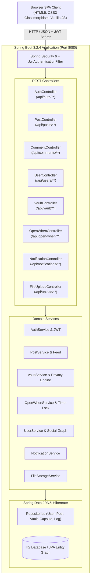

# ✦ LUMA — A Social Networking Platform with a Private Space for Expression

[](https://www.oracle.com/java/)
[](https://spring.io/projects/spring-boot)
[](https://spring.io/projects/spring-security)
[](https://www.h2database.com/)

**LUMA** is a full-stack social networking web platform built in Java. It unites two sides of digital expression:
1. **The Public Social Space:** Everyday moments, community feeds, following creators, likes, comments, exploration, and bookmarking.
2. **LUMA Vault:** A private, shielded digital haven for personal thoughts, memories, photographs, and feelings, protected with master PIN authentication, granular visibility (Strictly Private, Trusted Circles, Temporary Access), and real-time security activity audit trails.
3. **“Open When” Digital Time Capsules:** Sealed memories and letters of encouragement locked until a specific future date or milestone (birthdays, graduation, anniversaries, personal milestones).

---

## 🏗️ Architecture & Tech Stack



- **Backend Framework:** Java 17+, Spring Boot 3.2.4
- **Security & Tokens:** Spring Security 6, BCrypt Password & PIN Hashing, JJWT (HMAC-SHA256 Stateless Tokens)
- **Data Persistence:** Spring Data JPA, Hibernate, H2 Database (with H2 Web Console at `/h2-console`)
- **Frontend Architecture:** Modern, single-page application served directly from Spring Boot static resources (`src/main/resources/static`) — zero separate frontend servers required.
- **Media Uploads:** Local file handling via `FileUploadController` and `FileStorageService` mapped to `/uploads/**`.

---

## 🌟 Core Features

### 1. The Public Social Space
- **Interactive Feed:** Filter between *Discover All* and *Following Circle*.
- **Moment Publishing:** Post captions with hashtag parsing (`#VisualArts`, `#Engineering`, etc.), upload image files, or provide media URLs.
- **Engagements:** Real-time like toggle with animated heart icon, comments drawer for conversations, and bookmark/save toggle.
- **Explore & Search:** Full-text keyword search across posts and user profiles; tag filter pills.
- **User Profiles & Follows:** User bio, follower/following counts, recent posts, and saved bookmarks.

### 2. LUMA Vault (Private Sanctuary)
- **Shielded Gate:** Master 4-digit Vault PIN required before accessing private entries. Session auto-locks when switched or locked manually.
- **Granular Visibility Controls:**
  - `PRIVATE`: Strictly owner-only; invisible to all others.
  - `TRUSTED_CIRCLE`: Accessible only by designated companion usernames (e.g. `@sarah_art`).
  - `TEMPORARY_ACCESS`: Accessible for a specified duration before access is automatically revoked.
- **Classification & Moods:** Categorized by *Note*, *Feeling*, *Memory*, *Photograph*, *Milestone*, or *Video*, tagged with mood emojis.
- **Security Activity Audit Trail:** Full audit logging tracking every unlock, entry creation, viewing, sharing event, and IP address.

### 3. “Open When” Digital Time Capsules
- **Time-Locked Memories:** Prepare words of encouragement, photographs, or letters sealed until future moments:
  - *Birthdays*, *Graduation*, *Anniversaries*, *Milestones*, *Future Self*.
- **Live Countdown Timers:** Real-time clock counting down *Days : Hours : Minutes : Seconds* until the unlock date.
- **Passcode Override:** Optional secret passcode to unlock before the scheduled date.
- **Dramatic Reveal Modal:** Once conditions are satisfied, unlocks with celebration animation to reveal the hidden letter and attachment.

---

## 👥 Demo Pre-Populated Accounts

On startup, `DataInitializer` seeds four rich accounts ready for testing:

| Username | Password | Vault PIN | Role / Bio |
| :--- | :--- | :--- | :--- |
| **`hari`** | `password123` | `1234` | Software craftsman & creator of LUMA |
| **`sarah_art`** | `password123` | `1234` | Visual designer & analog film enthusiast |
| **`alex_dev`** | `password123` | `1234` | Distributed systems engineer |
| **`maya_travels`** | `password123` | `1234` | Travel documentarian |

> **Tip:** Use the **"Switch User" dropdown** in the header to instantly switch between accounts without typing passwords!

---

## 🚀 How to Run the Application

### Prerequisites
- **JDK 17 or higher** installed (`java -version`)
- **Maven 3.8+** installed (`mvn -version`)

### Step 1: Run with Maven
In the root directory of `LUMA`:

```bash
mvn spring-boot:run
```

Or on Windows using the helper:
```cmd
mvnw.cmd spring-boot:run
```

### Step 2: Open in Browser
Open your browser and navigate to:
```
http://localhost:8080
```

### Step 3: Access H2 Database Console (Optional)
To inspect the relational database tables directly:
- **URL:** `http://localhost:8080/h2-console`
- **JDBC URL:** `jdbc:h2:mem:lumadb`
- **User Name:** `sa`
- **Password:** `password`

---

## 📡 REST API Reference

### Authentication (`/api/auth`)
- `POST /api/auth/register` — Create a new LUMA account.
- `POST /api/auth/login` — Sign in and receive JWT token.
- `GET /api/auth/me` — Get current logged-in user details.
- `POST /api/auth/vault-pin/verify` — Verify Vault 4-digit PIN.
- `POST /api/auth/vault-pin/set` — Update Vault PIN.

### Posts & Public Moments (`/api/posts`)
- `GET /api/posts?feed=all|following&tag=...&query=...` — Fetch post stream.
- `POST /api/posts` — Create a new moment.
- `GET /api/posts/{id}` — Get single post by ID.
- `DELETE /api/posts/{id}` — Delete own post.
- `POST /api/posts/{id}/like` — Toggle like.
- `POST /api/posts/{id}/save` — Toggle bookmark.
- `GET /api/posts/saved` — Get saved posts.
- `GET /api/posts/user/{username}` — Get user's post history.

### Comments (`/api/comments`)
- `GET /api/comments/post/{postId}` — List comments on a post.
- `POST /api/comments/post/{postId}` — Add a comment.
- `DELETE /api/comments/{commentId}` — Delete comment.

### LUMA Vault (`/api/vault`)
- `GET /api/vault/entries?type=...` — Fetch private memories.
- `POST /api/vault/entries` — Secure a new memory.
- `GET /api/vault/entries/{id}` — View single private item (authorization checked).
- `DELETE /api/vault/entries/{id}` — Wipe vault memory.
- `GET /api/vault/shared` — View memories shared by companions.
- `GET /api/vault/stats` — Summary metrics (memories, encrypted, shared, capsules).
- `GET /api/vault/audit-logs` — Security activity audit log.

### Open When Capsules (`/api/open-when`)
- `GET /api/open-when/my` — Get created capsules.
- `GET /api/open-when/received` — Get capsules addressed to user.
- `POST /api/open-when` — Seal a new time or occasion capsule.
- `POST /api/open-when/{id}/unlock` — Unlock capsule with time validation or passcode.

### User Profiles & Follows (`/api/users`)
- `GET /api/users/{username}` — Get user profile and follower metrics.
- `PUT /api/users/profile` — Update bio, name, or avatar.
- `POST /api/users/{username}/follow` — Follow user.
- `DELETE /api/users/{username}/follow` — Unfollow user.
- `GET /api/users/search?q=...` — Search creators.
- `GET /api/users/suggested` — Suggested creators to follow.

### Notifications (`/api/notifications`)
- `GET /api/notifications` — List notifications.
- `GET /api/notifications/unread-count` — Count unread alerts.
- `POST /api/notifications/read-all` — Mark all as read.

---

## 🔒 Security & Privacy by Design
1. **Stateless JWT Tokens:** Authentication runs without server session memory; tokens expire after 24 hours.
2. **Dual-Layer Authentication:** The public profile and feed use account login, while the LUMA Vault has an independent Master PIN gate.
3. **Strict Authorization Checks:** Vault entries are protected at the service layer: only the owner or explicitly listed trusted circle users with valid expiration timestamps can retrieve entry contents.
4. **Audit Transparency:** Every access, creation, viewing, and unlock action is logged with timestamp and IP in `vault_audit_logs`.

---

© 2026 LUMA Platform. Built with Java, Spring Boot, and modern web standards.
